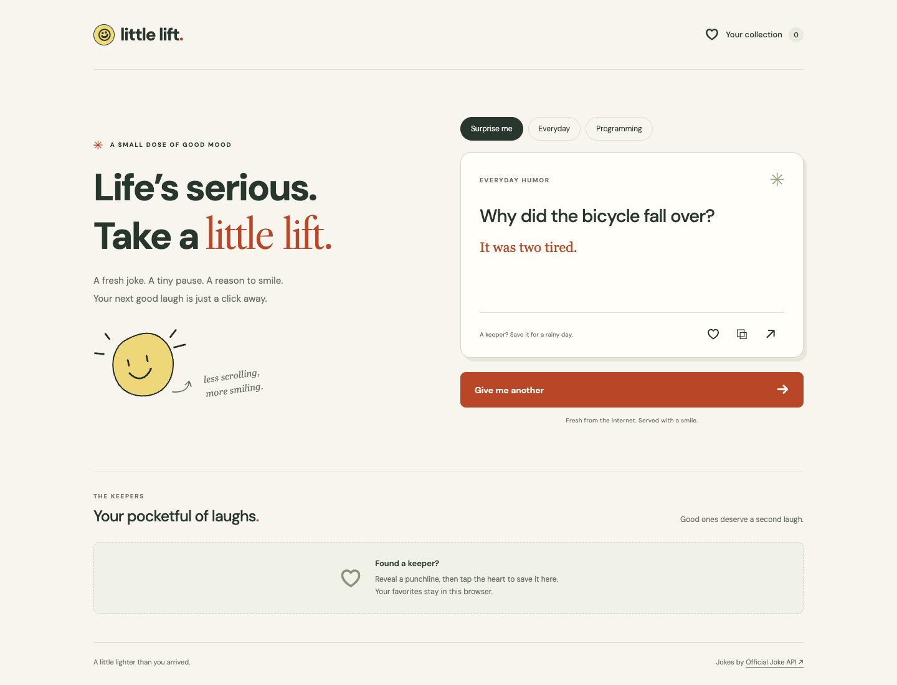

# Little Lift ☺

**A little break. A good laugh.** A responsive random joke generator built with HTML, CSS, and modern JavaScript. Fetch a joke, reveal the punchline, and keep your favorites for another day.



[View the mobile preview](docs/preview-mobile.png)

## Run locally

Install [Node.js](https://nodejs.org/) 22 or newer, then:

```bash
git clone https://github.com/Soumil-Makhija/little-lift.git
cd little-lift
npm start
```

Open **http://127.0.0.1:4173**. Running the app needs no package installation or API key. Internet access is required to fetch fresh jokes. Use a local web server rather than opening `index.html` directly, because the app uses JavaScript modules.

## Features

- **Random jokes on demand**, with Surprise me, Everyday, and Programming categories.
- **Reveal the punchline** when you are ready.
- **Save favorites** in your browser and remove them individually. Up to 100 favorites; no account required.
- **Copy or share** a complete joke. Sharing uses the device's share sheet where available and falls back to copying.
- **Responsive layout** for phones, tablets, and desktops.
- **Accessible controls** with keyboard navigation, visible focus, screen reader status updates, and reduced motion support.
- **Resilient requests** with a 10-second timeout, retry controls, response validation, and protection against duplicate clicks. A failed request preserves the current joke.
- **No runtime dependencies**, framework, build step, or secrets.

## Testing

```bash
npm ci
npm test
npx playwright install chromium
npm run test:e2e
```

On macOS with Google Chrome already installed, you can use Chrome instead of downloading Chromium:

```bash
PLAYWRIGHT_CHROME=1 npm run test:e2e
```

To additionally verify the real public service from the browser, run `LIVE_API_TEST=1 npm run test:e2e -- live.spec.js` (add `PLAYWRIGHT_CHROME=1` when using installed Chrome). This optional check is skipped by default so API outages do not break deterministic tests.

Unit tests cover API response validation, category URLs, network failures, cancellation, favorites storage, and copy formatting. Playwright tests cover the main user journeys, error recovery, timeouts, loading controls, safe text rendering, mobile overflow, persistence, clipboard behavior, and keyboard interaction at desktop and mobile sizes. GitHub Actions runs the tests on every push and pull request.

## Public API

Jokes come from the free [Official Joke API](https://github.com/15Dkatz/official_joke_api):

| Selection | Endpoint |
| --- | --- |
| Surprise me | `https://official-joke-api.appspot.com/random_joke` |
| Everyday | `https://official-joke-api.appspot.com/jokes/general/random` |
| Programming | `https://official-joke-api.appspot.com/jokes/programming/random` |

The app fetches directly from the browser over HTTPS. Category endpoints return an array; the random endpoint returns an object. Both formats are validated. The service is operated by a third party, so availability and joke content depend on that provider. If a repeat is returned, the app makes one additional request to try for a different joke.

## Privacy and browser support

Favorites are stored only in this browser's `localStorage`; they do not sync between devices. Clearing browser data removes them. If storage is blocked or full, favorites still work during the current visit and the app explains that they cannot persist. The joke provider receives normal API requests. Google Fonts provides the optional typefaces; system fonts are used if it is unavailable.

Copy and native sharing depend on browser support and a secure context (HTTPS or localhost). If copying is blocked, the app explains how to select the joke text manually. Recent Chrome, Edge, Firefox, and Safari support the app's core browser APIs; automated browser tests run in Chromium.

## Project structure

```text
index.html                  Page and accessible interface
src/app.js                  UI, requests, favorites, copying and sharing
src/core.js                 API validation and storage utilities
src/style.css               Responsive visual design
scripts/serve.mjs           Dependency-free local static server
tests/core.test.mjs          Unit tests
tests/browser/app.spec.js    Browser tests
.github/workflows/test.yml  Automated CI checks
```

## Static hosting

Deploy `index.html`, `favicon.svg`, and `src/` to any HTTPS static host. Relative asset paths work under a repository subpath. No build command is needed. The included server is for local development, not production hosting.
